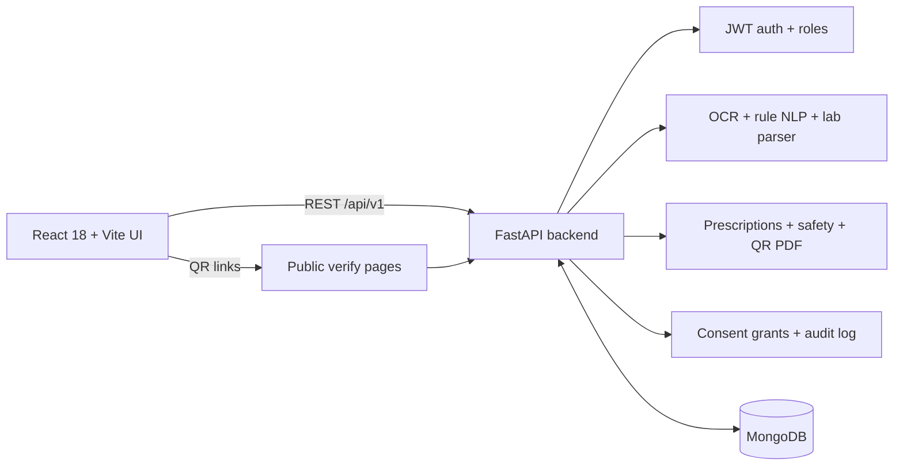

# Intelligent Medical Report Interpretation and Digital Healthcare System

A final-year engineering project: patients upload medical reports and get
plain-language AI explanations; doctors manage patients, digital
prescriptions, and follow-ups — with consent-based access, audit trails, and
safety guardrails throughout.

> **Educational prototype — not a medical device.** The app explains reports;
> it never diagnoses, never prescribes, and never replaces a doctor. Every AI
> output carries an "explanation, not a diagnosis" disclaimer. Reference-range
> and drug datasets are labelled educational, not clinical advice.

## Feature list

- **Report upload + OCR/NLP pipeline** (PDF/PNG/JPG/TXT; PaddleOCR/EasyOCR +
  rule-based medical NLP + LLM interpretation), background or synchronous mode.
- **Lab value flagging + longitudinal trends** — deterministic parser for 20+
  tests with unit normalization, printed-range priority, Low/Normal/High/Unknown
  badges, and standardized per-test trend analysis with reference bands,
  direction/events, template explanations, and patient exclude/correct controls.
- **Prescription safety** — 67-pair interaction dataset + allergy class map;
  severe flags block saving/issuing until acknowledged with a reason.
- **QR verification** — tamper-evident HMAC + QR in the PDF, public
  verification page, doctor revocation.
- **Reminders** — follow-up and course-end notifications (in-app; email only
  if SMTP is configured) with a scheduler + bell icon.
- **Emergency card** — printable PDF + revocable public page (3 fields only).
- **Handwritten scan → draft** — OCR + rules (validated LLM fallback), never
  auto-saved; doctor reviews first.
- **Consent + audit** — doctors request access, patients approve (with expiry)
  / deny / revoke; every PHI read/write and grant change is audit-logged;
  patient "who saw my data" view + admin audit search.
- **AI extras** — source-quote verification with highlighting, grounded
  report chat (refuses diagnosis/treatment questions), 8 explanation
  languages + listen button, JSON-repair retry + usage logs.
- **Evaluation chapter** — synthetic dataset + runner with P/R/F1, negation,
  lab accuracy, faithfulness + charts (see `docs/evaluation/`).
- **Hardening** — JSON registration with password policy, doctor verification
  queue, rate limits, refresh-token rotation, password reset, login lockout.

## Architecture



## Setup — local

Requirements: Python 3.12+, Node 20+, MongoDB running locally.

```bash
# Backend
cd backend
python -m venv .venv
.venv\Scripts\activate        # Windows; use source .venv/bin/activate on Linux
pip install -r requirements.txt
copy .env.example .env        # then edit .env (MongoDB, secrets, AI key)
.venv\Scripts\python -m pytest tests -q
uvicorn app.main:app --reload # http://localhost:8000 (docs at /docs)

# Optional heavy AI stack (OCR engines, SciSpacy for eval):
pip install -r requirements-ai.txt

# Seed the first admin (set ADMIN_EMAIL + ADMIN_PASSWORD first):
.venv\Scripts\python scripts/seed_admin.py

# Frontend
cd frontend
npm install
npm run dev                   # http://localhost:3000 (proxies /api to backend)
npm test -- --run             # Vitest unit tests
npm run build                 # production build
```

## Setup — Docker

```bash
# Optional: INSTALL_AI=true for the heavy OCR stack (default image stays small)
# Required env: SECRET_KEY (strong random), ADMIN_EMAIL/ADMIN_PASSWORD (first admin)
$env:SECRET_KEY="a-long-random-secret"
docker compose up --build
# Frontend: http://localhost:8080 (API proxied to backend)
```

> Docker could not be verified in this environment (no Docker binary) — treat
> the first `docker compose up` as a manual check (Definition of Done item).

## Environment variables

All variables are listed in `backend/.env.example` (safe defaults, no
secrets): MongoDB, JWT (`SECRET_KEY`, expiry), uploads, CORS, `ADMIN_*`
seed, `RATE_LIMIT_*`, `FRONTEND_URL`, `NOTIFICATIONS_ENABLED`,
`REMINDER_INTERVAL_HOURS`, `SMTP_*` (optional), `LLM_MODEL_INTERPRET`,
`LLM_MODEL_CHAT`, `SYNC_UPLOAD`, `OMNIROUTE_*`. Frontend: `frontend/.env.example`.

## API overview (prefix `/api/v1`)

| Area | Endpoints |
|---|---|
| Auth | `POST /auth/register` (JSON), `/login`, `/refresh`, `/logout`, `/forgot-password`, `/reset-password`, `GET /auth/me` |
| Admin | `GET /admin/pending-doctors`, `POST /admin/doctors/{id}/approve|reject` |
| Patients | `/patients/me`, `/patients/` (grant-filtered), `/{id}`, `/me/emergency-card`, emergency token rotate/revoke |
| Doctors | `/doctors/me` (verification state included) |
| Reports | `/reports/upload` (sync/async), `/`, `/{id}`, `/{id}/labs`, `/{id}/interpret?language=`, `/{id}/chat` |
| Health Trends | `GET /trends/summary`, `GET /trends/{canonical_test}`, `PATCH /trends/{canonical_test}/points/{report_id}` (patient only; `patient_id` required for doctors) |
| Prescriptions | `/`, `/doctor`, `/patient`, `/{id}`, `/{id}/pdf`, `/{id}/revoke`, `/scan` |
| Consent | `/access/requests`, `/requests/incoming|outgoing`, `/requests/{id}/approve|deny`, `/grants/mine|doctor`, `/grants/{id}` |
| Audit | `/audit/me`, `/audit/` (admin, filters) |
| Verify (public) | `/verify/prescription/{token}`, `/verify/emergency/{token}` |
| Notifications | `/notifications/`, `/{id}/read`, `/read-all` |

Interactive docs at `/docs` when the backend runs.

## Security model

- **Roles**: patient / doctor / admin. Registration is JSON-only with a
  password policy (8+ chars, letter + digit); admin self-registration rejected.
- **Doctors are verified**: new doctors are `pending` until an admin approves;
  every patient-data endpoint re-checks verification in the database on each
  request (nothing trusted from the JWT); unverified doctors see a
  pending-approval screen.
- **Consent**: verified doctors additionally need an active per-patient grant
  (scope + expiry) for reports/labs/trends/history/patient reads and
  prescribing. Reads without a grant return 404 (no existence leak); writes
  return 403. Patients approve/deny/revoke; doctors keep authored prescriptions.
- **Audit**: every PHI read/write and grant change is logged (actor, action,
  resource, patient, IP, user agent). Patients see their trail; admins search.
- **Rate limits** on login/register/upload/chat; **lockout** after 5 failed
  logins (15 min); **refresh rotation** + logout invalidation; **password
  reset** by emailed token (logged in dev when SMTP is unset).
- Secrets live only in `backend/.env` (git-ignored); `.env.example` is the
  complete list.

## Evaluation

Synthetic-only evaluation lives in `backend/evaluation/` with results and
charts in `docs/evaluation/` (`results.md`, `results.csv`, `METHODOLOGY.md`).
Headline (synthetic): rule-based F1 ≈ 0.89–1.0 on in-vocabulary types,
negation ≈ 0.76, lab flag/value 1.0, mock-LLM faithfulness ≈ 0.95. Read the
limitations section before quoting any number.

## Limitations and disclaimer

- Academic prototype: no clinical validation; reference ranges and drug data
  are teaching simplifications for adults — always confirm with professionals.
- The app explains; it does not diagnose, triage, or prescribe. Drug
  interaction checks are non-exhaustive.
- OCR needs the optional AI stack; without it, image uploads fail gracefully.
- Docker Compose is untested in CI here — verify on first run.
- See `DECISIONS.md` (assumptions), `PROGRESS.md` (status), `CHANGELOG.md`,
  and `USER_GUIDE.md` (non-technical demo script).
