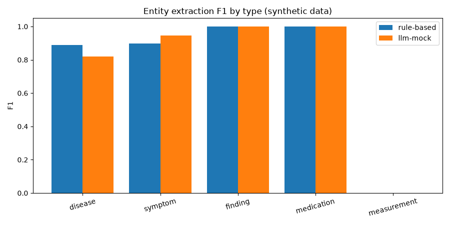
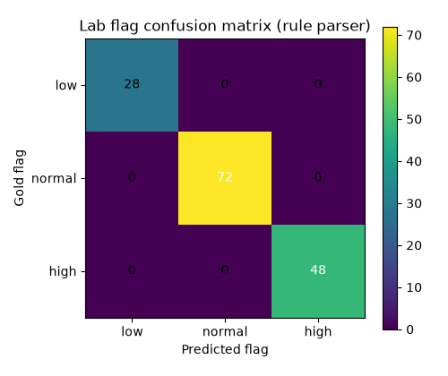

# Evaluation Results (synthetic data)

Records: 76 (30 generated + 46 lab fixture reuses). All data synthetic. See METHODOLOGY.md.

## Entity extraction (per type P/R/F1)

### rule-based

disease: P=1.00 R=0.80 F1=0.89 | symptom: P=1.00 R=0.82 F1=0.90 | finding: P=1.00 R=1.00 F1=1.00 | medication: P=1.00 R=1.00 F1=1.00 | measurement: P=0.00 R=0.00 F1=0.00

### llm-mock

disease: P=0.81 R=0.83 F1=0.82 | symptom: P=1.00 R=0.89 F1=0.94 | finding: P=1.00 R=1.00 F1=1.00 | medication: P=1.00 R=1.00 F1=1.00 | measurement: P=0.00 R=0.00 F1=0.00

SciSpacy status: skipped (ModuleNotFoundError: model/pipeline unavailable)

## Negation accuracy

rule-based: 0.760 · llm-mock: 1.000

## Lab parser accuracy

n=151 · flag accuracy=1.000 · value accuracy=1.000

## LLM faithfulness

llm-mock: 0.954 (125/131 quotes verified)

## Charts

_Limitations: mock LLM is a scripted stand-in, not a model; SciSpacy needs a downloaded biomedical model; lab gold labels derive from the same reference table (tests implementation, not medical validity)._ 
